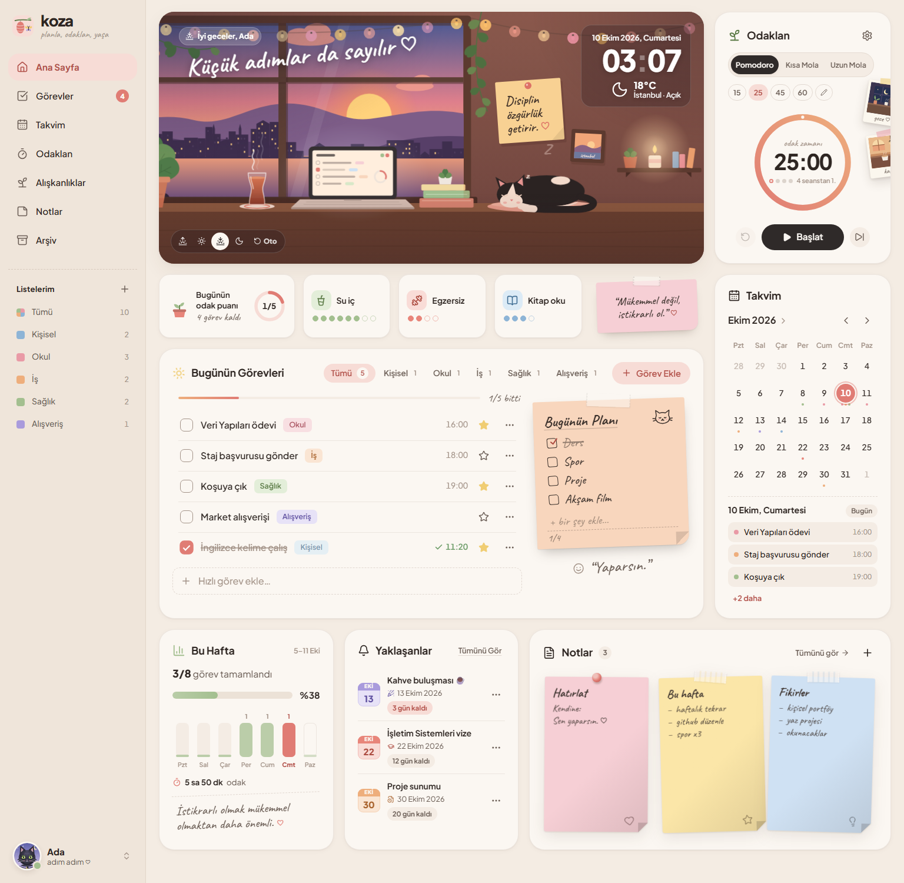
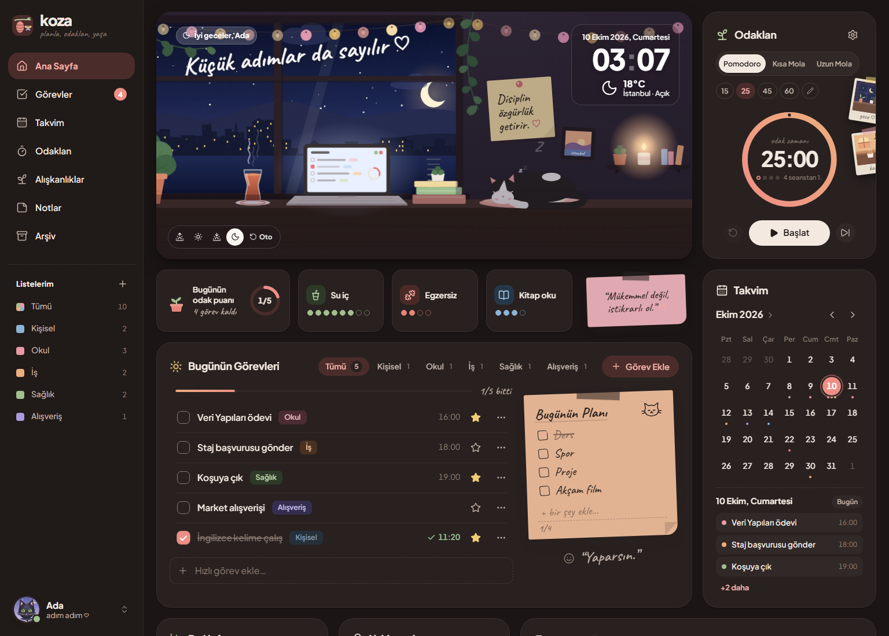
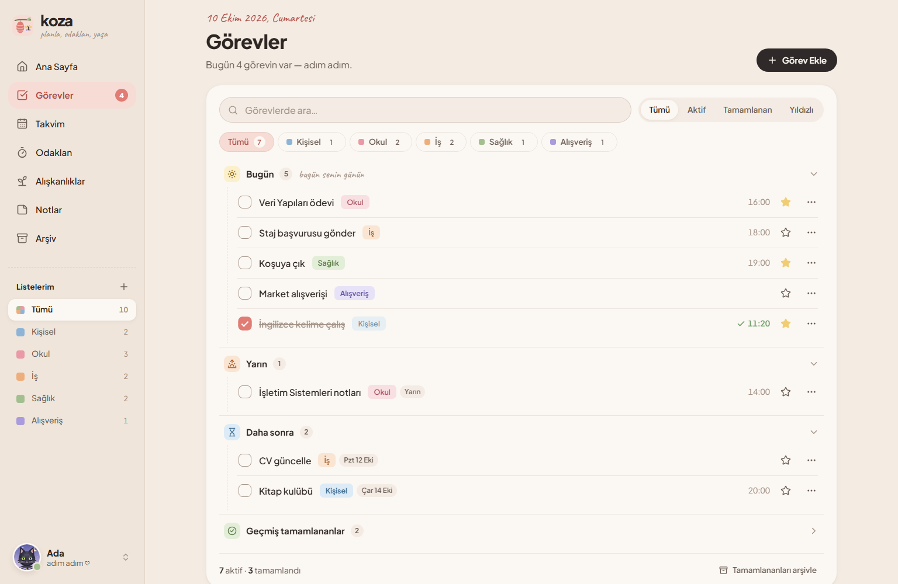
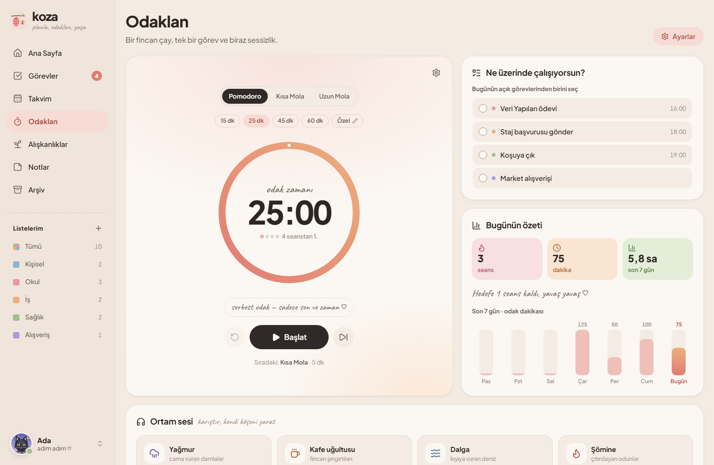
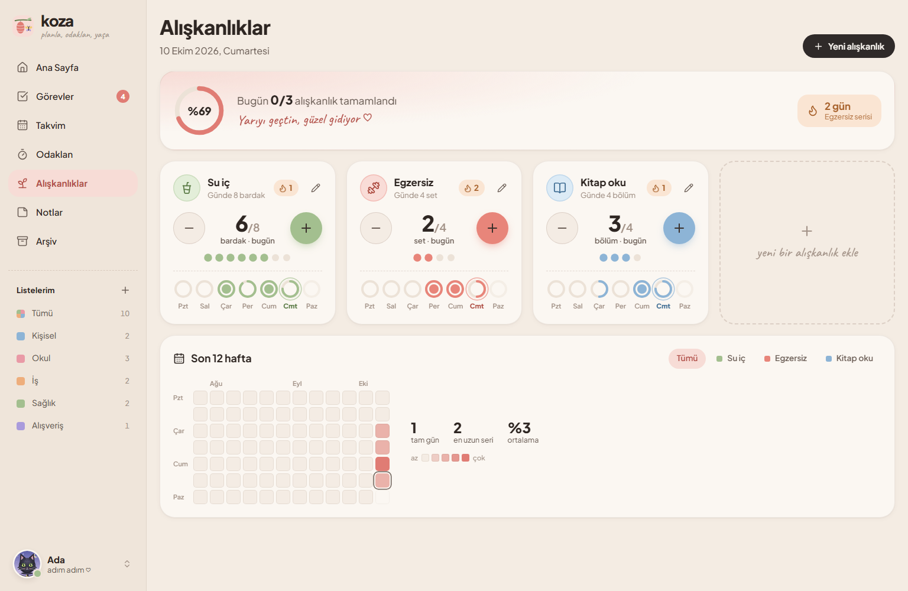
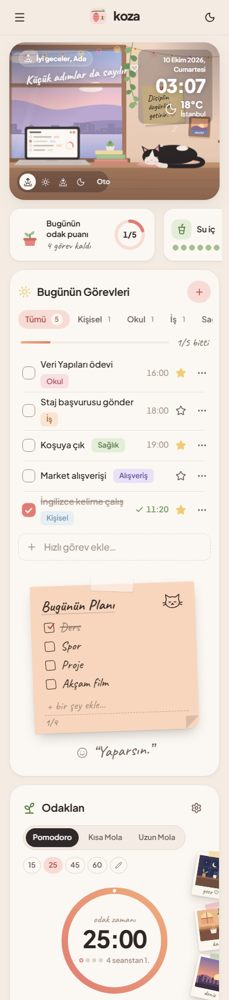

<p align="center">
  
</p>

<h1 align="center">Koza</h1>

<p align="center"><em>planla, odaklan, yaşa</em></p>

<p align="center">
  Görevleri, odak zamanını, alışkanlıkları ve notları tek bir sıcak panoda toplayan,<br />
  React + Vite ile geliştirilmiş günlük planlayıcı.
</p>

<p align="center">
  <a href="https://koza-planlayici.netlify.app"><strong>Canlı demo</strong></a>
</p>



---

## İçindekiler

- [Proje hakkında](#proje-hakkında)
- [Özellikler](#özellikler)
- [Ekran görüntüleri](#ekran-görüntüleri)
- [Kullanılan teknolojiler](#kullanılan-teknolojiler)
- [Kurulum ve çalıştırma](#kurulum-ve-çalıştırma)
- [Proje yapısı](#proje-yapısı)
- [Mimari ve teknik notlar](#mimari-ve-teknik-notlar)
- [Yayınlama](#yayınlama)

## Proje hakkında

**Koza**, bir yapılacaklar listesinden fazlası olarak tasarlandı: günü planlamayı, odaklanarak çalışmayı ve küçük alışkanlıkları sürdürmeyi bir arada destekler. İsmi, kozanın içinde yavaş yavaş gerçekleşen değişimden gelir; küçük ve düzenli adımlarla hayatı dolu dolu yaşamak fikrini temsil eder.

Arayüz "lofi" bir masa başı atmosferinden ilham alır. Ana sayfadaki pencere sahnesi günün saatine ve gerçek hava durumuna göre değişir.

Uygulama tamamen tarayıcıda çalışır, bir sunucuya ihtiyaç duymaz. Her kullanıcının verisi yalnızca kendi tarayıcısında (`localStorage`) saklanır.

## Özellikler

### Ana sayfa
- Günün saatine göre **sabah / gün / akşam / gece** görünümüne geçen, SVG ile çizilmiş pencere sahnesi
- Canlı saat, tarih ve kullanıcının konumuna göre **hava durumu**; yağmur, kar ve sis sahneye de yansır
- Günün odak puanı, alışkanlık sayaçları, haftalık ilerleme, yaklaşan etkinlikler ve notlardan oluşan özet kartlar

### Görevler
- Görev ekleme, düzenleme, tamamlama, yıldızlama ve yarına erteleme
- Renkli **listeler**: ekleme, silme ve listeye göre filtreleme
- Arama ile durum filtreleri: tümü / aktif / tamamlanan / yıldızlı
- Tarihe göre gruplama: gecikmiş, bugün, yarın, bu hafta, daha sonra
- Silinen görevler önce **Arşiv**'e taşınır; oradan geri alınabilir ya da kalıcı olarak silinebilir
- Yapışkan not görünümünde **"Bugünün Planı"** kontrol listesi

### Odaklan (Pomodoro)
- Pomodoro, kısa mola ve uzun mola modları
- Hazır süreler (15, 25, 45 ve 60 dk) veya **özel süre** (1–180 dk)
- Sayfalar arasında geçiş yapıldığında ya da sayfa yenilendiğinde çalışmaya devam eden zamanlayıcı
- Seans bitiminde tarayıcı bildirimi ve yumuşak bir çan sesi
- Odaklanılan görevi seçme, günlük istatistikler ve 7 günlük odak grafiği
- Gerçek saha kayıtlarından oluşan **ortam sesleri** (yağmur, kafe, dalga, şömine); her ses ayrı ayrı açılıp seviyesi ayarlanabilir ve kayıtlar kesintisiz döngüde çalar

### Takvim
- Görevleri ve etkinlikleri gösteren ay görünümü
- Sınav, teslim, etkinlik ve seyahat türünde etkinlikler
- "Yaklaşanlar" kartında geri sayım (ör. "3 gün kaldı")

### Alışkanlıklar
- Günlük hedefli alışkanlıklar (ör. 8 bardak su)
- Seri (streak) takibi, haftalık halkalar ve 12 haftalık **ısı haritası**
- Simge, renk, hedef ve birim seçerek yeni alışkanlık oluşturma

### Notlar
- Renkli yapışkan notlardan oluşan mantar pano
- Sabitleme, arama, renge göre filtreleme
- Rastgele bir yazma önerisiyle not açan "İlham" butonu

### Genel
- İlk girişte ad ve konum soran **karşılama ekranı**
- Profil: ad, motto, şehir ve 7 farklı ayı avatarı (boz ayı, kutup ayısı, panda, oyuncak ayı…) arasından seçim
- **Gece modu** (koyu tema)
- Mobil uyumlu tasarım: 360 px genişliğe kadar test edildi
- Klavye ile kullanılabilir arayüz ve ekran okuyucular için `aria` etiketleri

## Ekran görüntüleri

| Gece modu | Görevler |
|---|---|
|  |  |

| Odaklan | Alışkanlıklar |
|---|---|
|  |  |

<p align="center">
  
</p>

## Kullanılan teknolojiler

| Alan | Teknoloji |
|---|---|
| Arayüz | [React 19](https://react.dev) (fonksiyon bileşenleri ve hook'lar) |
| Geliştirme ve derleme | [Vite 8](https://vite.dev) |
| İkonlar | [lucide-react](https://lucide.dev) |
| Stil | Saf CSS: CSS değişkenleri (design token), container query, CSS animasyonları |
| Veri saklama | `localStorage` (React Context ile) |
| Hava durumu | [Open-Meteo](https://open-meteo.com) API (anahtarsız) |
| Konumdan şehir adı | [BigDataCloud](https://www.bigdatacloud.com) reverse geocoding (anahtarsız) |
| Ses | Web Audio API; ortam sesleri için [Wikimedia Commons](https://commons.wikimedia.org) kayıtları ([kaynaklar](public/sounds/CREDITS.md)) |
| Kod kalitesi | [oxlint](https://oxc.rs) |
| Yayın | [Netlify](https://www.netlify.com) |

Harici bir UI kütüphanesi kullanılmadı; bileşenler, illüstrasyonlar ve animasyonlar projeye özel olarak yazıldı.

## Kurulum ve çalıştırma

Gereksinim: **Node.js 20.19+** (veya 22.12+)

```bash
# bağımlılıkları yükle
npm install

# geliştirme sunucusunu başlat (http://localhost:5173)
npm run dev
```

| Komut | Açıklama |
|---|---|
| `npm run dev` | Geliştirme sunucusunu başlatır |
| `npm run build` | Üretim için `dist/` klasörüne derler |
| `npm run preview` | Derlenmiş sürümü yerelde önizler |
| `npm run lint` | Kodu oxlint ile denetler |

## Proje yapısı

```
koza/
├── index.html              # HTML giriş noktası (yazı tipleri, tema)
├── netlify.toml            # Netlify derleme ayarları
├── public/
│   ├── favicon.svg         # Koza logosu
│   └── sounds/             # Ortam sesi kayıtları (mp3) ve CREDITS.md
├── docs/screenshots/       # README görselleri
└── src/
    ├── main.jsx            # React giriş noktası
    ├── App.jsx / App.css   # Uygulama iskeleti, sayfa geçişleri, pano grid'i
    ├── index.css           # Tasarım token'ları (renkler, gölgeler…) ve ortak sınıflar
    ├── store/
    │   ├── AppStore.jsx    # Uygulama durumu + localStorage kalıcılığı (AppProvider)
    │   ├── useApp.js       # useApp / useListMap hook'ları
    │   └── seed.js         # İlk açılıştaki varsayılan listeler ve alışkanlıklar
    ├── lib/                # Tarih, konum ve id yardımcıları
    ├── components/         # Ortak bileşenler (Modal, Icon)
    └── features/           # Özellik bazlı klasörler
        ├── shell/          # Kenar menü, logo, karşılama ekranı, ayı avatarları
        ├── home/           # Pencere sahnesi, hava durumu, alışkanlık şeridi, haftalık özet
        ├── tasks/          # Görev kartı, Görevler sayfası, Arşiv
        ├── focus/          # Pomodoro zamanlayıcısı, ortam sesleri
        ├── calendar/       # Takvim ve Yaklaşanlar
        ├── habits/         # Alışkanlıklar sayfası ve ısı haritası
        └── notes/          # Yapışkan notlar
```

Kod **özellik bazlı** düzenlendi: her klasör kendi bileşenlerini, stil dosyalarını ve yardımcı fonksiyonlarını içerir. Sınıf isimleri her özellik için ayrı bir önek kullanır (ör. `.tt-`, `.fw-`, `.cw-`), böylece stiller birbiriyle çakışmaz.

## Mimari ve teknik notlar

- **Durum yönetimi:** Tüm veriler (`todos`, `lists`, `notes`, `habits`, `events`, `user`…) `AppProvider` içinde tutulur ve her değişiklikte `localStorage`'a `koza:` önekiyle yazılır. Bileşenler veriye `useApp()` hook'u ile erişir.
- **Sayfa geçişleri:** Harici bir router kullanılmadı. Aktif sayfa URL'deki hash değerinden okunur (ör. `#/tasks`), böylece tarayıcının geri butonu da çalışır.
- **Zamanlayıcı doğruluğu:** Pomodoro, kalan saniyeyi saymak yerine bitiş zamanını (`Date.now()` tabanlı) saklar. Bu sayede arka plandaki sekmelerde kaymaz ve sayfa yenilense bile kaldığı yerden devam eder.
- **Tema:** Tüm renkler `index.css` içindeki CSS değişkenlerinden gelir. Gece modu yalnızca bu değişkenleri değiştirir. Tema, sayfa yüklenmeden önce uygulanarak açılıştaki renk "parlaması" önlenir.
- **İllüstrasyonlar:** Pencere sahnesi, ayı avatarları, logo ve polaroidler satır içi SVG olarak çizildi; arayüzde PNG/JPG gibi hazır görseller kullanılmadı.
- **Gizlilik:** Konum yalnızca kullanıcı izin verirse alınır. Hava durumu servislerine yalnızca koordinat veya şehir adı gönderilir.

## Yayınlama

Proje Netlify'a hazır yapılandırılmıştır (`netlify.toml`):

- Derleme komutu: `npm run build`
- Yayın klasörü: `dist`

Netlify CLI ile:

```bash
npx netlify-cli deploy --prod --dir dist
```

Alternatif olarak GitHub deposu Netlify'a bağlanarak her `push` sonrasında otomatik yayın alınabilir.
